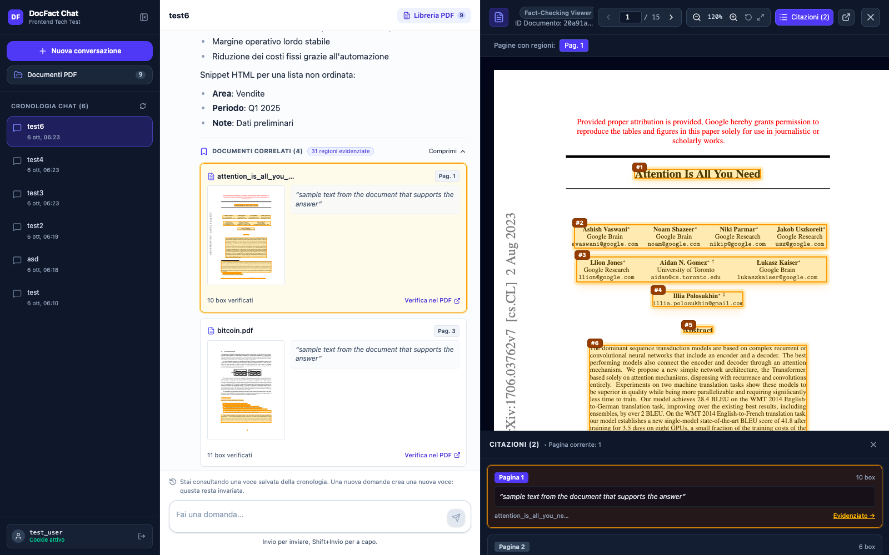
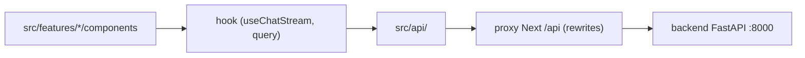
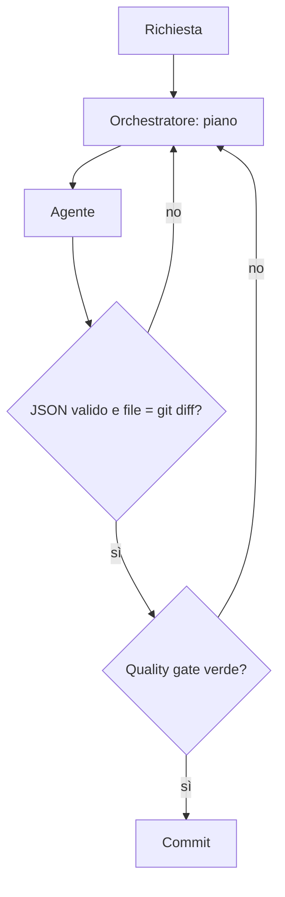

# DocFact Chat & Citations

Interfaccia web per fare domande a un backend che risponde in streaming sui documenti PDF caricati.
Le risposte arrivano in Markdown con HTML inline sanitizzato. Ogni citazione si apre in un viewer PDF con le regioni evidenziate.



## Stack

- Next.js 15 (App Router), React 19, TypeScript 5.9
- TanStack Query 5 per il server state
- Tailwind CSS 4
- `react-pdf` 11 per il viewer PDF
- `react-markdown` 9 con `remark-gfm`, `rehype-raw` e `rehype-sanitize`
- Vitest, Testing Library e MSW per unit e integration; Playwright per gli e2e

## Avvio rapido

Prerequisiti: Node 22 (come nel `Dockerfile`), npm, Docker.
Il backend è nel repo `test-tecnico-frontend-engineer`, da clonare come cartella sorella: `../test-tecnico-frontend-engineer`.

Passo 1: avvia il backend (porta 8000).

```bash
cd ../test-tecnico-frontend-engineer
docker-compose up --build
```

Passo 2, in locale:

```bash
npm ci
npm run dev
```

Passo 2, in alternativa con Docker. Il compose del frontend avvia anche il backend sulla rete interna (porta 8000 non pubblicata, Swagger non raggiungibile dall'host salvo aggiungere `ports` in `docker-compose.yml`), quindi il passo 1 non serve.

```bash
docker compose up --build
```

Apri `http://localhost:3000` e accedi con un `user_id` di prova, per esempio `demo`.
Regole: non vuoto, al massimo 100 caratteri, solo lettere ASCII, cifre, `-` e `_`.

## Configurazione

| Variabile | Default | Scopo |
|---|---|---|
| `BACKEND_URL` | `http://localhost:8000` | Destinazione del proxy `/api`. Letta a build time (`next.config.ts`). Nel compose è `http://backend:8000`. |
| `PLAYWRIGHT_BASE_URL` | non impostata | Se impostata, gli e2e usano un server già avviato, pensato come build di produzione (es. `npm run build && npm run start`, o Docker): `e2e/hygiene.spec.ts` applica allora le soglie di produzione (1 richiesta invece delle 2 di StrictMode in dev). Altrimenti Playwright avvia `npm run dev` su `http://localhost:3000`. |

Il browser parla solo con `localhost:3000`. Next inoltra `/api/*` al backend con i `rewrites` di `next.config.ts`, perché il CORS del backend (`*` con credenziali) non è usabile dal browser.
Il cookie `user_id` è impostato dal backend ed è `HttpOnly`: il codice JS non lo legge.

## Script

| Script | Cosa fa |
|---|---|
| `npm run dev` | Server di sviluppo su porta 3000 |
| `npm run build` | Build standalone; `postbuild` copia `static` e `public` |
| `npm run start` | Avvia la build standalone (serve prima `npm run build`) |
| `npm run lint` | ESLint |
| `npm run typecheck` | `tsc --noEmit` |
| `npm run test` | Vitest: unit e integration |
| `npm run e2e` | Playwright |
| `npm run gen:api` | Genera i tipi di request da `docs/api/openapi.json` |
| `npm run clean` | `next clean` |

## Struttura del progetto

```text
app/              App Router: layout, pagina, stili
src/api/          Livello API unico: client, auth, documenti, chat, NDJSON, errori, paginazione
src/components/   UI condivisa (MarkdownRenderer) e provider TanStack Query
src/features/     auth, chat, documents, factcheck, history (components, hooks, lib)
src/mocks/        Handler MSW per i test
src/test/         Utility di test
tests/            unit, integration, fixtures
e2e/              Spec Playwright
scripts/          Copia degli asset per la build standalone
docs/             Specifica, audit, roadmap, ADR, schema OpenAPI
.claude/          Agenti, hook e impostazioni del sistema di sviluppo
```

## Architettura



`fetch` è ammesso solo in `src/api/`: lo impone la regola ESLint `no-restricted-globals` in [`eslint.config.mjs`](eslint.config.mjs). Il livello `src/api/` usa solo URL relativi e normalizza gli errori.
`chat` compone le altre feature (`ChatWorkspace.tsx`); le altre feature non si importano tra loro e `src/api/` non importa da `src/features/` ([ADR 0002](docs/adr/0002-struttura-per-feature.md)).
Lo stato del server è in TanStack Query; lo stato dello stream è un `useReducer` in `src/features/chat/lib/chatStreamReducer.ts`.

## Note su streaming e PDF

**Streaming NDJSON.** [`src/api/ndjson.ts`](src/api/ndjson.ts) legge il corpo con `TextDecoder`, divide sulle righe, tiene il buffer della riga incompleta e ignora i tipi di chunk sconosciuti. Le righe malformate producono un errore esplicito. [`useChatStream.ts`](src/features/chat/hooks/useChatStream.ts) accumula i delta e li applica una volta per frame. "Interrompi" usa un `AbortController` e lascia il testo parziale con stato `aborted`.

**Rendering PDF e coordinate.** Le bounding box del backend sono in pollici, con origine in alto a sinistra. [`coordinates.ts`](src/features/factcheck/lib/coordinates.ts) le converte in pixel: pollici × 72 = punti, punti × (larghezza renderizzata / larghezza pagina in punti) = pixel. Nessun ribaltamento dell'asse y. Il worker di pdf.js è servito in locale.

**Sanitizzazione HTML.** [`MarkdownRenderer.tsx`](src/components/ui/MarkdownRenderer.tsx) applica `rehype-raw` e poi `rehype-sanitize`. In `src/` e `app/` non c'è nessun `dangerouslySetInnerHTML`.

## Test

- Unit: `tests/unit/` (23 file). Integration: `tests/integration/` (26 file). Eseguiti con `npm run test`.
- e2e: `e2e/` (21 spec Playwright), con `npm run e2e`.
- Controlli statici: `npm run typecheck` e `npm run lint`.
- Se i browser Playwright non sono installati: `npx playwright install`.
- Gli e2e richiedono il backend attivo su `localhost:8000`.

## Decisioni e trade-off

| Decisione | Trade-off | Dettaglio |
|---|---|---|
| Proxy same-origin con i `rewrites` di Next | Serve un server Next (niente static export); `BACKEND_URL` fissata a build time | [ADR 0001](docs/adr/0001-proxy-same-origin.md) |
| Struttura per feature con un solo livello `src/api/` | Più cartelle; `chat` è l'unica feature che ne importa altre | [ADR 0002](docs/adr/0002-struttura-per-feature.md) |
| Invio disabilitato durante lo stream | Un clic in più (o "Interrompi"), nessuna race sullo storico | [ADR 0003](docs/adr/0003-invio-durante-stream.md) |
| Una voce di storico è una coppia domanda/risposta | Il contesto multi-turno si perde al ricarico (limite del backend) | [ADR 0004](docs/adr/0004-modello-storico.md) |
| Multi-turno solo nel client; `history` inviato per compatibilità con lo schema, ma ignorato dal backend | La UI non promette che la risposta tenga conto del contesto; se il backend lo usasse, funzionerebbe senza modifiche | [ADR 0004](docs/adr/0004-modello-storico.md) |
| Paginazione letterale a 20 elementi | Chat recenti visibili solo dopo "Carica altre" | [ADR 0005](docs/adr/0005-paginazione-letterale.md) |
| Override di `postcss` per le vulnerabilità | Restano 5 avvisi high solo nelle dipendenze di sviluppo | [ADR 0006](docs/adr/0006-gestione-vulnerabilita-dipendenze.md) |
| Feedback esplicito sulla voce salvata nello storico | Con più di 20 chat la voce può non essere tra le pagine caricate | [ADR 0007](docs/adr/0007-feedback-storico.md) |
| Viewer PDF a scroll continuo con rendering lazy | Letture delle dimensioni di tutte le pagine all'apertura | [ADR 0008](docs/adr/0008-viewer-scroll-continuo.md) |
| TanStack Query per documenti e storico | Una dipendenza in più rispetto a `fetch` negli hook | [P1-06](docs/ROADMAP.md) |
| `useReducer` con batching per frame per lo stream | Più codice di un `useState` per delta | [P1-03](docs/ROADMAP.md) |
| `react-pdf` con worker locale | Nessuna richiesta a CDN esterne | [P1-08](docs/ROADMAP.md) |

## Limiti noti

- **Backend** ([`docs/AUDIT.md`](docs/AUDIT.md), Assunzioni 9–10 e §2): `text_quote` è sempre la stessa frase placeholder, quindi la UI evidenzia solo le bounding box.
- **Backend:** documenti globali e non per utente; `page_count` sempre 5.
- **Backend:** ignora `history` e salva ogni chat come una sola coppia domanda/risposta. Il contesto multi-turno esiste solo nel browser, in memoria, nella sessione attiva. Si perde ricaricando la pagina, selezionando un'altra voce dello storico o iniziando una nuova conversazione ([ADR 0004](docs/adr/0004-modello-storico.md)). `localStorage` conserva solo lo `user_id`.
- **Backend:** OpenAPI senza schemi di risposta (tipi scritti a mano in `src/api/types.ts`); nessun endpoint di logout.
- **Frontend:** il logout cancella solo lo stato client; il cookie `HttpOnly` resta.
- **Frontend:** "Annulla" sull'upload interrompe la richiesta, ma il file può risultare già salvato.
- **Frontend:** a 1280 px, con sidebar e viewer aperti, il nome file nell'header del viewer è troncato (finding aperto, low).

## Con più tempo

Dettagli negli item aperti e nei findings di [`docs/ROADMAP.md`](docs/ROADMAP.md).

- **Chat e navigazione:** autoscroll all'invio quando il log è scorso in alto, avviso se un cambio di chat scarta una domanda in corso, stato nell'URL per "indietro" e ricarico, togliere il testo tecnico "multipart/form-data" dal tab di upload.
- **Viewer PDF:** nome file troncato nell'header a 1280 px, "Ripristina 100%" che oggi porta lo zoom al 120%, avviso per pagina citata fuori range, meno Tab per la regione "Pagina PDF".
- **Rendering delle risposte:** bloccare le immagini esterne ammesse dalla sanitizzazione, togliere l'attributo `node` dai `<code>` inline.
- **Test:** e2e indipendenti dal numero di documenti nel backend e da `PLAYWRIGHT_BASE_URL` su un dev server.
- **Dipendenze:** chiudere i 5 avvisi high solo-dev quando `eslint-config-next` avrà un fix ([ADR 0006](docs/adr/0006-gestione-vulnerabilita-dipendenze.md)).
- **Con un backend aggiornato:** endpoint di logout per cancellare il cookie; evidenziare il `text_quote` nel text layer se il backend restituirà testo reale.

## Metodo di sviluppo

Il progetto è stato sviluppato con l'assistenza di modelli AI, in un processo progettato dall'autore, che decide e verifica.

**Fase 1: scaffolding.** Un meta-prompt, cioè un prompt che genera prompt strutturati con ruoli, vincoli e criteri di validazione espliciti e una revisione critica prima della consegna, ha prodotto il prompt per Google AI Studio Build. Da quel prompt è nata la prima versione dell'app. Si è usato uno strumento dedicato per risparmiare token nell'impalcatura iniziale.

**Fase 2: sistema di subagenti.** Un secondo meta-prompt ha generato il prompt con cui Claude Code ha configurato il sistema in [`CLAUDE.md`](CLAUDE.md) e [`.claude/`](.claude/), con attenzione a ruoli e flusso di validazione. Lo sviluppo è proseguito per iterazioni guidate da [`docs/ROADMAP.md`](docs/ROADMAP.md): 45 item, tutti `done`.

| Agente | Modello | Ruolo |
|---|---|---|
| Sessione principale (orchestratore) | modello della sessione | Pianifica, delega, valida, committa; non modifica codice, test o documentazione |
| `frontend-developer` | sonnet | Codice sorgente |
| `frontend-test-writer` | sonnet | Test unit, integration ed e2e |
| `frontend-tester` | sonnet | Verifica esplorativa della UI con Playwright |
| `documentation-writer` | haiku | README, CHANGELOG, roadmap, ADR |

Il modello è scelto per ruolo per contenere i costi: haiku per la documentazione, sonnet per sviluppo e test, override a opus solo per decisioni trasversali ([`CLAUDE.md`](CLAUDE.md) E.7).

Flusso di validazione:
1. L'orchestratore non modifica codice, test o documentazione: lo impone [`guard-orchestrator.mjs`](.claude/hooks/guard-orchestrator.mjs).
2. Ogni agente chiude con un JSON strutturato, controllato da [`validate-agent-output.mjs`](.claude/hooks/validate-agent-output.mjs) (hook `SubagentStop`).
3. I file dichiarati nel JSON sono confrontati con `git diff` ([`CLAUDE.md`](CLAUDE.md) E.5).
4. Il quality gate esegue typecheck, lint e test ([`quality-gate.mjs`](.claude/hooks/quality-gate.mjs), hook `Stop`).



**Ruolo dell'autore.** Ho progettato il processo: i due meta-prompt, i ruoli degli agenti, la scelta del modello per ruolo e le regole di validazione in [`CLAUDE.md`](CLAUDE.md). Durante lo sviluppo ho scelto le priorità della roadmap e quali findings trasformare in item e quali rinviare, per esempio dopo le verifiche esplorative con Playwright, e ho rivisto la UI chiedendo correzioni di UX e microcopy (empty state, hint del composer, sottotitolo del login, sidebar collassata).

**Limiti del metodo.**
- Il controllo dei comandi Bash in `guard-orchestrator.mjs` è best-effort: non copre ogni scrittura.
- Il quality gate non esegue gli e2e.
- La roadmap è un unico file Markdown ([`docs/ROADMAP.md`](docs/ROADMAP.md)), scelta voluta per questioni di tempo; in un sistema di produzione si userebbe uno strumento più mantenibile, per esempio un issue tracker con un item per issue.
- Dopo 2 blocchi consecutivi il validatore lascia decidere l'orchestratore.
- `.claude/state/` e `.claude/reports/` non sono versionati: piani e report non sono consultabili dal clone.
